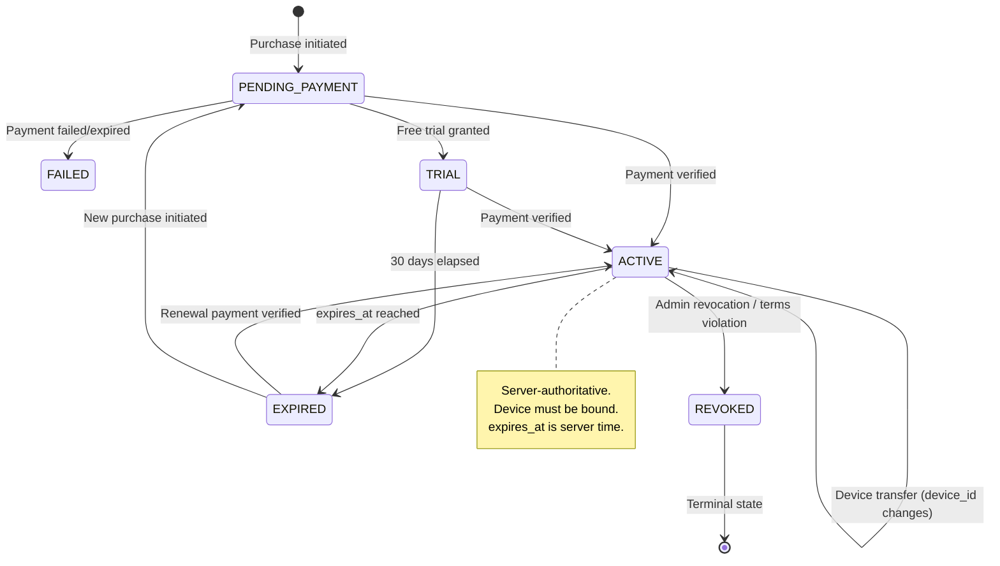

# Eligius Subscription System — Security & License Architecture

**Version:** 1.0  
**Date:** 2026-11-10  
**Status:** Design Phase — Not Implemented

---

## 1. Overview

This document details the security architecture and license enforcement system for the Eligius subscription platform. The design follows a **defense-in-depth** approach with server-authoritative validation, cryptographic device binding, and offline entitlement support.

### 1.1 Security Goals

1. **Device Binding** — One active device per user, cryptographically enforced
2. **License Integrity** — Server-authoritative validation + offline signed entitlements
3. **Payment Integrity** — Server-to-server verification, idempotent callbacks
3. **Token Security** — Keystore-encrypted storage, short-lived JWTs, refresh rotation
4. **Replay Protection** — Nonces, timestamps, challenge-response
4. **Auditability** — Immutable logs for all financial/license events

### 1.2 Threat Model Summary

| Threat | Severity | Mitigation |
|--------|----------|------------|
| License reuse on multiple devices | CRITICAL | Device binding + server enforcement |
| Payment callback forgery | CRITICAL | S2S verification + idempotency keys |
| Device ID spoofing | HIGH | Keystore-backed keys + challenge-response |
| Trial reset via reinstall | HIGH | Account-keyed trial (device state irrelevant — see 05 §5.1) |
| Token theft (rooted device) | HIGH | Keystore encryption + short JWT TTL |
| Clock tampering | HIGH | elapsedRealtime monotonic anchor + wall-rollback detection + auto-time signal (§4.4); **reboot+offline rollback gap documented honestly** — server-side retroactive detection is the backstop |
| Replay attacks | HIGH | Nonces, timestamps, challenge-response |
| Modified app bypass | HIGH | Server-authoritative enforcement |

---

## 2. Device Identity & Registration

### 2.1 Device Identity Model

```
┌─────────────────────────────────────────────────────────────────┐
│                    DEVICE IDENTITY MODEL                        │
├─────────────────────────────────────────────────────────────────┤
│                                                                 │
│  Android Device                                                 │
│  ┌─────────────────────────────────────────────────────────┐   │
│  │  Android Keystore (Hardware-backed when available)     │   │
│  │  ┌─────────────────────────────────────────────────┐   │   │
│  │  │ Ed25519 / ECDSA P-256 Key Pair                │   │   │
│  │  │ • Private Key: Non-exportable, hardware-backed │   │   │
│  │  │ • Public Key: Exported for registration        │   │   │
│  │  └─────────────────────────────────────────────────┘   │   │
│  │                           │                              │   │
│  │                           ▼                              │   │
│  │  ┌─────────────────────────────────────────────────┐   │   │
│  │  │ Device Fingerprint                              │   │   │
│  │  │ SHA-256(public_key || ANDROID_ID) = device_hash │   │   │
│  │  └─────────────────────────────────────────────────┘   │   │
│  └─────────────────────────────────────────────────────────┘   │
│                                                                 │
│  Registration Flow:                                             │
│  1. App generates keypair in Keystore                           │
│  2. Computes device_hash = SHA-256(pubkey || ANDROID_ID)       │
│  3. Sends pubkey + device_hash + label to /devices/register    │
│  3. Server stores device_hash + public_key + user_id           │
│  4. Device bound to user account (one active device/user)      │
└─────────────────────────────────────────────────────────────────┘
```

### 2.2 Device Registration Protocol

**Client (Android):**
```kotlin
// 1. Generate/retrieve keypair from Keystore
val keyPair = KeyStoreManager.getOrCreateKeyPair("eligius_device_key")

// 2. Compute device fingerprint
val androidId = Settings.Secure.getString(contentResolver, Settings.Secure.ANDROID_ID)
val pubKeyBytes = keyPair.public.encoded
val fingerprint = sha256(pubKeyBytes + androidId.toByteArray())

// 3. Register with server
val request = DeviceRegistrationRequest(
    publicKey = keyPair.public.toPemString(),
    fingerprint = fingerprint.toHex(),
    label = "My Device"
)
api.registerDevice(request)
```

**Server (eligius-otp.php extended):**
```php
function register_device($user_id, $public_key_pem, $fingerprint, $label) {
    global $wpdb;
    
    // Verify fingerprint matches public key
    $pubkey = openssl_pkey_get_public($public_key_pem);
    $pubkey_der = openssl_pkey_get_details($pubkey)['key'];
    $expected_fingerprint = hash('sha256', $pubkey_der . $android_id);
    
    if (!hash_equals($fingerprint, $expected_fingerprint)) {
        throw new Exception('Invalid device fingerprint');
    }
    
    // Check one-device-per-user
    $existing = $wpdb->get_var($wpdb->prepare(
        "SELECT id FROM {$wpdb->prefix}eligius_devices 
         WHERE user_id = %d AND is_active = 1",
        $user_id
    ));
    
    if ($existing) {
        return ['conflict' => true, 'existing_device_id' => $existing];
    }
    
    // Insert device
    $wpdb->insert("{$wpdb->prefix}eligius_devices", [
        'user_id' => $user_id,
        'device_hash' => $fingerprint,
        'public_key' => $public_key_pem,
        'label' => $label,
        'is_active' => 1
    ]);
    
    return ['device_id' => $wpdb->insert_id];
}
```

### 2.3 Device Authentication Protocol

```
┌─────────────────────────────────────────────────────────────────┐
│              DEVICE AUTHENTICATION FLOW                         │
├─────────────────────────────────────────────────────────────────┤
│                                                                 │
│  CLIENT                          SERVER                         │
│    │                                │                            │
│    │── POST /devices/challenge ────►│                            │
│    │  { device_hash }               │                            │
│    │                                │                            │
│    │◄── { challenge, expires_in }───│                            │
│    │  (32-byte random, 60s TTL)     │                            │
│    │                                │                            │
│    │  sign(challenge) with          │                            │
│    │  device private key            │                            │
│    │                                │                            │
│    │── POST /devices/verify ───────►│                            │
│    │  { device_hash, challenge,    │                            │
│    │    signature }                 │                            │
│    │                                │                            │
│    │        verify signature        │                            │
│    │        with stored pubkey      │                            │
│    │                                │                            │
│    │◄── { verified: true } ────────│                            │
│    │                                │                            │
└─────────────────────────────────────────────────────────────────┘
```

**Server Challenge Verification:**
```php
function verify_device_challenge($device_hash, $challenge_b64, $signature_b64) {
    global $wpdb;
    
    // Get device
    $device = $wpdb->get_row($wpdb->prepare(
        "SELECT id, public_key FROM {$wpdb->prefix}eligius_devices 
         WHERE device_hash = %s AND is_active = 1",
        $device_hash
    ));
    
    if (!$device) {
        throw new Exception('Device not found');
    }
    
    // Decode challenge & signature
    $challenge = base64_decode($challenge_b64);
    $signature = base64_decode($signature_b64);
    
    // Verify Ed25519/ECDSA signature
    $pubkey = openssl_pkey_get_public($device->public_key);
    $result = openssl_verify($challenge, $signature, $pubkey, OPENSSL_ALGO_SHA256);
    
    if ($result !== 1) {
        throw new Exception('Invalid signature');
    }
    
    // Mark device as seen
    $wpdb->update(
        "{$wpdb->prefix}eligius_devices",
        ['last_seen_at' => current_time('mysql')],
        ['id' => $device->id]
    );
    
    return ['verified' => true, 'device_id' => $device->id];
}
```

### 2.4 Signature Algorithm Choice — CONFIRMED DECISION (CD-10, formerly TD-8)

> **Status:** **CONFIRMED by the owner on 2026-11-13.** The device-binding signature mechanism is **Android Keystore ECDSA P-256 (NIST secp256r1)** with `SHA256withECDSA` signatures. Server license signing remains **Ed25519 (sodium)** — independent responsibility, not interchangeable (see §4.2). Hardware attestation is **not** required and Keystore generation must not be presented as proof of hardware-backed storage.

**Decision: Android Keystore + ECDSA P-256 (secp256r1), SHA256withECDSA signatures.**

Why this mechanism fits device binding:

| Criterion | ECDSA P-256 in Android Keystore |
|-----------|--------------------------------|
| Non-exportability | Keys generated inside Android Keystore cannot be extracted as key material (hardware-backed TEE/StrongBox on most modern devices; software fallback on others) |
| Availability | `KeyPairGenerator` + `ECGenParameterSpec("secp256r1")` works on API 23+ — covers the app's minSdk 26 |
| Signature size | ~70 bytes (DER) — compact for REST payloads |
| No extra permissions | Uses the platform Keystore; no READ_PHONE_STATE, no IMEI, no device identifiers |
| Server verification | Standard PHP `openssl_verify()` — no exotic dependencies |

**Alternatives evaluated (documented for the record):**

| Alternative | Verdict | Reason |
|-------------|---------|--------|
| Ed25519 (Keystore) | Not chosen as primary | Keystore Ed25519 exists only on API 28+ via Conscrypt and is device-dependent. May be revisited as an optional runtime upgrade |
| RSA-2048 | Rejected | 256-byte signatures, slower key generation, no security advantage over P-256 at this scale |
| HMAC shared secret | Rejected | The secret must live on the client → extractable on rooted devices → strictly weaker than asymmetric challenge-response |
| Play Integrity API | Rejected as binding primitive | Requires Google Play Services + a network round-trip per check — unreliable in the target market. Usable later as an optional *additional signal*, not as the binding mechanism |
| IMEI / factory serial | Rejected | Not accessible to ordinary apps (API 26+ restrictions); policy-inappropriate — see audit §7 |

**Known limitations (stated honestly — carried from the audit):**
- **Uninstall destroys the keys.** Android 6.0+ wipes app-scoped Keystore keys on uninstall; a fresh install generates a new pair → a new `device_hash`. Device binding therefore does **not** survive reinstall and is **not** a trial-reset control (trial is account-keyed per CD-6 — see 05 §3.1).
- **Hardware backing varies** — TEE/StrongBox on most modern devices; plain software Keystore on others and on emulators. Non-exportability weakens on software-backed keys under root.
- **Rooted devices** can bypass Keystore protections entirely; server-side enforcement remains the authoritative boundary in all cases.

### 2.5 One Active Device — Server-Side Enforcement & Concurrency Control (CD-9)

**Confirmed policy:** each account can use the VPN on **exactly one active device at any time** — for the trial AND all paid plans alike. Transfer requires **OTP verification**; after a successful transfer the previous device is immediately no longer authorized.

**Enforcement points (server-authoritative):**

| Point | Mechanism | Reference |
|-------|-----------|-----------|
| Device registration | Transactional bind: `SELECT … FOR UPDATE` on the user's active-device row; a concurrent second bind receives `DEVICE_LIMIT_REACHED` (409) | 02 §2.8 |
| License binding | `license.device_id` is a single column — binding moves atomically during transfer; two devices can never share a license | 02 §2.8, §3.2 |
| Device transfer | OTP-verified transaction deactivates the old device (`is_active=0`) and moves the binding in one commit | 05 §6 |
| VPN connect | License validation matches `license.device_id` against the requesting `device_hash` — a deauthorized old device fails with `DEVICE_NOT_BOUND` | 04 §5.1 |
| Periodic tick (≤5 min) | Same check while the tunnel is UP — a device that loses its binding (e.g., after a transfer from it) is disconnected at the next tick | 04 §5.1, CD-5 |

**Concurrency guarantee:** ALL device-changing operations (first registration, re-registration, transfer, binding change) acquire **one shared fixed lock point** — the account's own `wp_users` row via `SELECT … FOR UPDATE` — before any eligibility read (02 §2.8). This makes `bind` vs `transfer` races structurally impossible: both paths serialize on the same lock, so two parallel requests can never both succeed, and two active devices can never exist. All involved tables are InnoDB; every statement's result and `$wpdb->last_error` are checked explicitly (wpdb does not throw) with ROLLBACK on any failure. Full transaction and acceptance criteria in 02 §2.8.

**Validation failure codes for a deauthorized old device:** `DEVICE_NOT_BOUND` (binding moved) or `DEVICE_LIMIT_REACHED` (limit hit at registration).

---

## 3. License Architecture

### 3.1 License Model

```
┌─────────────────────────────────────────────────────────────────┐
│                    LICENSE ENTITY                               │
├─────────────────────────────────────────────────────────────────┤
│                                                                 │
│  License {                                                      │
│    id: BIGINT                 // Primary key                    │
│    user_id: BIGINT            // FK → wp_users                  │
│    device_id: BIGINT|null     // FK → eligius_devices (NULL=trial)│
│    plan_key: VARCHAR(32)      // monthly, quarterly, etc.      │
│    plan_label: VARCHAR(64)    // Display name                  │
│    duration_days: SMALLINT    // 30, 90, 180, 365, 30          │
│    started_at: DATETIME       // Server timestamp              │
│    expires_at: DATETIME       // Server timestamp              │
│    status: ENUM               // ACTIVE, EXPIRED, REVOKED,     │
│                               // PENDING_PAYMENT, TRIAL         │
│    source: VARCHAR(32)        // trial, payment, admin, renewal│
│    payment_id: BIGINT|null    // FK → eligius_payments         │
│    previous_license_id: BIGINT|null // Renewal chain           │
│    signed_blob: TEXT|null     // Signed offline entitlement    │
│    blob_expires_at: DATETIME  // Offline entitlement expiry    │
│    public_key_id: VARCHAR(32) // Key version for verification  │
│    created_at, updated_at    │
│ }                                                               │
└─────────────────────────────────────────────────────────────────┘
```

### 3.2 License State Machine



### 3.3 License Status Transitions

| From | To | Trigger | Server Action |
|------|-----|---------|---------------|
| `PENDING_PAYMENT` | `ACTIVE` | Payment verified | Create license, set `expires_at = now() + duration` |
| `PENDING_PAYMENT` | `FAILED` | Payment failed/timeout | Mark payment `FAILED` |
| `PENDING_PAYMENT` | `TRIAL` | Trial granted | Create trial license (30 days) |
| `TRIAL` | `ACTIVE` | Payment verified | Upgrade to paid, extend expiry |
| `TRIAL` | `EXPIRED` | 30 days elapsed | Auto-transition via cron |
| `ACTIVE` | `EXPIRED` | `expires_at` reached | Cron job processes daily |
| `ACTIVE` | `REVOKED` | Admin action / violation | Immediate, invalidate offline blob |
| `ACTIVE` → `ACTIVE` | Renewal | Extend `expires_at` by plan duration |
| `EXPIRED` | `ACTIVE` | Renewal payment verified | Extend from `now()` if expired, from `expires_at` if active |
| `EXPIRED` | `PENDING_PAYMENT` | New purchase | New payment flow |
| `REVOKED` | — | Terminal | No transitions |

---

## 4. Offline Entitlement System

### 4.1 Signed Offline Entitlement Blob

The Android app can operate offline for up to **72 hours** using a signed entitlement blob.

```
┌─────────────────────────────────────────────────────────────────┐
│              OFFLINE ENTITLEMENT BLOB (JWT)                     │
├─────────────────────────────────────────────────────────────────┤
│                                                                 │
│  Header:                                                        │
│  {                                                              │
│    "alg": "EdDSA",                                              │
│     // or "ES256" for ECDSA P-256                              │
│    "typ": "JWT",                                                │
│    "kid": "v2"                                                  │
│  }                                                              │
│                                                                 │
│  Payload:                                                       │
│  {                                                              │
│    "iss": "eligius-subscription",                               │
│    "sub": "user_123",           // user_id                      │
│    "aud": "eligius-android",                                      │
│    "jti": "uuid-v4",            // unique token ID              │
│    "iat": 1699632000,           // issued at (server time)      │
│    "exp": 1699891200,           // iat + 72 hours (max)         │
│    "nbf": 1699632000,           // not before                    │
│    "license_id": 123,                                                      │
│    "plan_key": "annual",                                                │
│    "permissions": [                                                       │
│      "vpn.connect",                                                       │
│      "vpn.split_tunnel",                                                  │
│      "vpn.lan_share"                                                      │
│    ],                                                                     │
│    "device_hash": "a1b2c3d4...",                                         │
│    "device_id": 42                                                        │
│  }                                                                      │
│                                                                 │
│  Signature: Ed25519(private_key, header_b64 + "." + payload_b64)        │
│                                                                 │
│  Compact: header_b64.payload_b64.signature_b64                              │
│                                                                 │
└─────────────────────────────────────────────────────────────────┘
```

### 4.2 Offline Entitlement Issuance

**Server (LicenseIssuer):**
```php
class Eligius_Sub_License_Issuer {
    private $signing_key_id = 'v2'; // Rotated every 90 days
    private $private_key; // Ed25519 private key (never leaves server)
    private $max_offline_hours = 72;
    
    public function issue_offline_entitlement($license_id, $device_id): array {
        $license = $this->license_repo->find($license_id);
        $device = $this->device_repo->find($device_id);
        
        if (!$license || !$device) {
            throw new Exception('License or device not found');
        }
        
        if ($license->device_id !== $device->id) {
            throw new Exception('Device not bound to license');
        }
        
        $now = time();
        $exp = $now + ($this->max_offline_hours * 3600);
        
        $payload = [
            'iss' => 'eligius-subscription',
            'sub' => (string)$license->user_id,
            'aud' => 'eligius-android',
            'jti' => bin2hex(random_bytes(16)),
            'iat' => $now,
            'exp' => $exp,
            'nbf' => $now,
            'license_id' => $license->id,
            'plan_key' => $license->plan_key,
            'permissions' => ['vpn.connect', 'vpn.split_tunnel', 'vpn.lan_share'],
            'device_hash' => $device->device_hash,
            'device_id' => $device->id
        ];
        
        $header = ['alg' => 'EdDSA', 'typ' => 'JWT', 'kid' => $this->signing_key_id];
        
        $header_b64 = $this->base64url_encode(json_encode($header));
        $payload_b64 = $this->base64url_encode(json_encode($payload));
        $signing_input = $header_b64 . '.' . $payload_b64;
        
        $signature = $this->sign($signing_input);
        $signature_b64 = $this->base64url_encode($signature);
        
        $blob = $signing_input . '.' . $signature_b64;
        
        // Store blob reference for revocation checking
        $this->license_repo->update($license_id, [
            'signed_blob' => $blob,
            'blob_expires_at' => date('Y-m-d H:i:s', $exp),
            'public_key_id' => $this->signing_key_id
        ]);
        
        return [
            'blob' => $blob,
            'expires_at' => date('c', $exp),
            'public_key_id' => $this->signing_key_id
        ];
    }
    
    private function sign($data) {
        // Ed25519 signing using sodium or openssl
        return sodium_crypto_sign_detached($data, $this->private_key);
    }
}
```

### 4.3 Android Offline Validation

```kotlin
// Embedded public key (rotated via app update)
const val EMBEDDED_PUBLIC_KEYS = mapOf(
    "v1" to "MCowBQYDK2VwAyEA...",
    "v2" to "MCowBQYDK2VwAyEA...",
    "v3" to "MCowBQYDK2VwAyEA..."
)

class OfflineEntitlementValidator {
    data class ValidationResult(
        val isValid: Boolean,
        val licenseId: Long? = null,
        val deviceHash: String? = null,
        val expiresAt: Long = 0,
        val permissions: List<String> = emptyList(),
        val error: String? = null
    ) {
        companion object {
            fun Valid(licenseId: Long, deviceHash: String, expiresAt: Long, permissions: List<String>) =
                ValidationResult(true, licenseId, null, expiresAt, permissions)
            
            fun Expired() = ValidationResult(false, error = "EXPIRED")
            fun Invalid(error: String) = ValidationResult(false, error = error)
        }
    }
    
    // Embedded public keys (rotated via app updates)
    private const val EMBEDDED_PUBLIC_KEYS = mapOf(
        "v1" to "MCowBQYDK2VwAyEA...",
        "v2" to "MCowBQYDK2VwAyEA...",
        "v3" to "MCowBQYDK2VwAyEA..."
    )
    
    fun validate(blob: String): ValidationResult {
        val parts = blob.split(".")
        if (parts.size != 3) return ValidationResult.Invalid("Invalid JWT format")
        
        val (headerB64, payloadB64, signatureB64) = parts.toList()
        
        // Decode header
        val headerJson = base64UrlDecode(headerB64)
        val header = JSONObject(headerJson)
        val kid = header.optString("kid")
        val alg = header.optString("alg")
        
        val pubKeyPem = EMBEDDED_PUBLIC_KEYS[kid] 
            ?: return ValidationResult.Invalid("Unknown key ID: $kid")
        
        // Verify signature
        val signingInput = "$headerB64.$payloadB64"
        val signature = base64UrlDecode(signatureB64)
        if (!verifySignature(signingInput, signature, pubKeyPem, alg)) {
            return ValidationResult.Invalid("Signature verification failed")
        }
        
        // Parse payload
        val payloadJson = base64UrlDecode(payloadB64)
        val payload = JSONObject(payloadJson)
        
        // Validate claims
        val now = System.currentTimeMillis() / 1000
        val exp = payload.optLong("exp", 0)
        val nbf = payload.optLong("nbf", 0)
        
        if (now >= exp) return ValidationResult.Expired()
        if (now < nbf) return ValidationResult.Invalid("Token not yet valid")
        
        if (payload.optString("aud") != "eligius-android") {
            return ValidationResult.Invalid("Invalid audience")
        }
        
        return ValidationResult.Valid(
            licenseId = payload.optLong("license_id"),
            deviceHash = payload.optString("device_hash"),
            expiresAt = exp * 1000L,
            permissions = payload.optJSONArray("permissions")?.toStringList() ?: emptyList()
        )
    }
    
    private fun base64UrlDecode(input: String): String {
        var output = input.replace('-', '+').replace('_', '/')
        val padding = 4 - input.length % 4
        if (padding != 4) output += "=".repeat(padding)
        return String(Base64.decode(output, Base64.URL_SAFE or Base64.NO_WRAP), StandardCharsets.UTF_8)
    }
    
    private fun verifySignature(data: String, signature: ByteArray, pubKeyPem: String, alg: String): Boolean {
        return if (alg == "EdDSA") {
            // Ed25519 verification using sodium or bouncycastle
            org.bouncycastle.crypto.signers.Ed25519Signer().run {
                init(false, org.bouncycastle.crypto.params.Ed25519PublicKeyParameters(
                    org.bouncycastle.util.encoders.Base64.decode(pubKeyPem.replace("-----BEGIN PUBLIC KEY-----", "").replace("-----END PUBLIC KEY-----", "").trim()),
                    0
                ))
                update(data.toByteArray(StandardCharsets.UTF_8))
                verifySignature(signature)
            }
        } else if (alg == "ES256") {
            // ECDSA P-256
            val pubKey = java.security.KeyFactory.getInstance("EC").generatePublic(
                java.security.spec.X509EncodedKeySpec(
                    android.util.Base64.decode(pubKeyPem.replace("-----BEGIN PUBLIC KEY-----", "").replace("-----END PUBLIC KEY-----", "").trim(), Base64.NO_WRAP)
                )
            )
            val sig = java.security.Signature.getInstance("SHA256withECDSA").apply { initVerify(pubKey) }
            sig.update(data.toByteArray(StandardCharsets.UTF_8))
            sig.verify(signature)
        } else false
    }
}
```

### 4.4 Time Integrity — Defending the 72-Hour Window Against Clock Manipulation

The offline entitlement is a JWT whose `exp` equals `iat + 72h` in **server epoch time**. The client must decide "have 72 hours elapsed?" without trusting the device wall clock, because the wall clock is user-controlled.

**The attack:** the user rolls the system clock backwards (or disables the network and freezes the clock) so the client-side `exp` check never fires, extending offline VPN usage indefinitely.

**Honest conclusion stated up front:** on stock Android there is **no cryptographically trusted local time source** available to third-party apps. Client-side time enforcement is a **deterrence layer against casual abuse** — not a security boundary. After a device reboot with the network disabled and the clock rolled back, reliable local detection is **impossible**; the authoritative bound is server-side enforcement at the next online contact. The layers below raise the cost of abuse; none provide a mathematical guarantee.

#### Layer 1 — Monotonic anchor while the device is running (strong)

At every successful online validation, persist (EncryptedSharedPreferences) alongside the entitlement blob:

| Field | Source | Purpose |
|-------|--------|---------|
| `anchorElapsedRealtime` | `SystemClock.elapsedRealtime()` | Monotonic ms-since-boot — **immune to wall-clock changes, includes deep-sleep time** |
| `anchorBootCount` | `Settings.Global.BOOT_COUNT` | **Reboot detector** — this system counter increments on every boot and persists across reboots; unlike the elapsed comparison, it detects a reboot even when the elapsed value has been reset |
| `anchorWallClock` | `System.currentTimeMillis()` | Boot-gap fallback reference |
| `entitlementExp` | JWT `exp` claim | Absolute server-epoch bound |

While the device runs, consumed offline time = `elapsedRealtime() − anchorElapsedRealtime`; the entitlement is expired when consumed ≥ 72 h. `elapsedRealtime()` keeps counting through deep sleep, so normal idle time is measured correctly (no artificial gaps).

Additional sanity check: if `currentTimeMillis() < anchorWallClock − 60s` → wall-clock rollback detected → deny the offline entitlement and require online validation.

#### Layer 2 — Reboot handling via BOOT_COUNT (strict policy — no offline after reboot)

The primary reboot detector is **`Settings.Global.BOOT_COUNT`** — a system counter that increments on every boot and persists across reboots. **Available since API 24** (world-readable via `Settings.Global`, no permissions needed). The app's `minSdk = 26` exceeds this threshold, so BOOT_COUNT is guaranteed on every device that can run Eligius. Readable by any app without permissions; not writable without root (root can tamper — see the rooted-device boundary below).

**OWNER-CONFIRMED POLICY (finalization pass 5):** any `BOOT_COUNT` change since the anchor → **offline entitlement DISCARDED immediately, online validation MANDATORY**. No wall-clock fallback, no monotonic-only path, no partial-rollback exception.

**Decision table:**

| BOOT_COUNT state | Wall clock | Offline granted? |
|------------------|------------|-----------------|
| Readable at anchor **AND** equal at check | Any (≥ anchor − 60s tolerance) | ✓ FULL mode — monotonic budget continues |
| Readable at anchor but **different** at check | Any | ✗ **DENIED** — reboot detected → previous entitlement discarded → online required |
| **Unreadable** at anchor **or** at check | Any | ✗ **DENIED** — online validation is the only path |
| Any state + `AUTO_TIME == 0` | Any | ✗ **DENIED** — user controls the clock |

**API availability:** `Settings.Global.BOOT_COUNT` requires **API 24**; the app's `minSdk = 26` exceeds this, so BOOT_COUNT is guaranteed on every device that can run Eligius. `Settings.Global.AUTO_TIME` (key `"auto_time"`) is available since API 17 and readable without permissions on all supported devices.

**AUTO_TIME limitation (honest — no false guarantees):** `AUTO_TIME == 1` only confirms that the **user has not disabled** the "Automatic date & time" toggle in system settings. It does **NOT** prove that the Android `time_detector` service is successfully syncing time — the service could fail silently (no network, unreachable NTP, DNS failure) while the toggle remains ON. For a normal (non-system, non-privileged) third-party app, there is **no API to verify** the time_detector service's actual synchronization status: the `MANAGE_TIME_AND_ZONE_DETECTION` permission is `signature|privileged` and unavailable to ordinary apps. Therefore, `AUTO_TIME == 1` is a **weak positive signal** (user hasn't manually overridden) and MUST always be combined with the other time-integrity layers (BOOT_COUNT anchor, elapsedRealtime monotonic check, server-side retroactive detection). If the product ever requires definitive verification of time accuracy, the API limitation must be documented and an alternative approach (e.g., server-side time comparison on every contact) is the only viable path for a normal app.

On devices below API 24 (impossible with `minSdk = 26`), the offline entitlement would be denied and online validation mandatory — recorded here for completeness in case `minSdk` is ever lowered.

**Why this eliminates the previously documented "partial rollback gap":**

| Attack | Old permissive behavior | New strict behavior |
|--------|------------------------|---------------------|
| Reboot + rollback clock (partial, after anchor) | Wall-based estimate used → attacker gains rolled-back time | **BOOT_COUNT mismatch → offline DENIED immediately** — gap eliminated |
| Reboot + rollback clock (full, before anchor) | Wall < anchor → detected → deny ✓ | Same → deny ✓ |
| No reboot, clock rolled back while running | elapsedRealtime catches it (monotonic) → deny ✓ | Same → deny ✓ |

The only remaining attack surface is rooted devices (see below) — no client-side mechanism provides security there, and server-side retroactive detection is the backstop.

**Anchor lifecycle:** after every successful online validation → `anchor()` stores new `BOOT_COUNT` + new `elapsedRealtime()` + new `anchorWallClock` + new entitlement `exp`. The old entitlement blob is discarded.

#### Layer 3 — Server-side retroactive detection (authoritative)

- `eligius_devices.last_seen_at` is already stored on every successful device authentication.
- At the next online contact, the server computes the true elapsed gap using **server clocks**. Policy hook (implemented in P6):
  - If a device requests a new offline entitlement while the server-side gap since `last_seen_at` exceeds 72 h + tolerance → write audit event `entitlement.time_anomaly` (severity `WARNING`) and queue the license for admin review.
  - Optional admin toggle: auto-suspend after N anomalies.
- This converts undetectable offline abuse into **retroactively attributable abuse**: the attacker evades enforcement only while permanently offline; the moment they reconnect, the anomaly is on record.

#### Options Comparison

| Option | While running | Across reboot | Rooted devices | Complexity | Verdict |
|--------|---------------|---------------|----------------|------------|---------|
| Wall clock only | ✗ | ✗ | ✗ | Trivial | **Rejected** — trivially defeated |
| elapsedRealtime anchor (Layer 1) | ✓ | ✗ | ✗ | Low | **Adopted** |
| + BOOT_COUNT strict policy (Layer 2) | ✓ | ✓ (any mismatch → offline DENIED) | ✓ | Low | **Adopted** — primary reboot detector; eliminates the reboot+rollback gap |
| + **BOOT_COUNT hard prerequisite** (pass 5) | ✓ | ✓ (offline denied without it) | ✓ | None (policy, not mechanism) | **Adopted** — eliminates the reboot+rollback gap entirely by denying offline when BOOT_COUNT is missing/unreadable |
| + auto-time requirement | ✓ | Partial (deterrent) | ✗ | Low | **Adopted** (hardening signal) |
| + server-side retroactive flagging (Layer 3) | n/a (server) | ✓ at next contact | ✓ | Medium | **Adopted** (authoritative backstop) |
| TEE trusted time / remote time attestation | ✓ | ✓ | Partial | High | **Rejected** — no stock-API mechanism for third-party apps |
| Play Integrity time signals | ✓ | ✓ | Partial | Medium | **Deferred** — needs Google Play Services + connectivity per check; unreliable in target market. Optional future signal only |

#### Rooted Devices

On a rooted device, encrypted preferences can be decrypted, `elapsedRealtime()` can be hooked (Xposed), and every client-side layer is bypassable. **No client-side time mechanism provides security on rooted devices.** Client-side time integrity is a casual-abuse deterrent only; the authoritative controls are server-side (revocation, validation, anomaly flagging).

#### Conditions Under Which Reliable Local Determination Is Impossible (Documented)

1. Device rebooted + network unavailable + wall clock rolled back **to a point after the anchor** → locally undetectable until the next online contact.
2. Rooted/hooked device → all client-side state and clocks manipulable.
3. `AUTO_TIME` disabled → no network-provided time reference.
5. `AUTO_TIME` enabled (`== 1`) but the `time_detector` service fails silently (no NTP reach, DNS failure) → the toggle is ON but the clock may still be wrong. **No API exists for a normal app to verify the service's actual sync status** — `MANAGE_TIME_AND_ZONE_DETECTION` is `signature|privileged`. `AUTO_TIME == 1` is therefore a weak positive signal only; the other time-integrity layers (BOOT_COUNT anchor, elapsedRealtime, server-side retroactive check) are the compensating controls.
4. Patched framework → even `elapsedRealtime()` can be spoofed.

In these conditions the app MUST deny the offline entitlement and require one successful online validation, or — if the owner prefers a softer policy (TD-9) — allow usage while marking the session for server-side review.

---

## 5. License Validation Flow

### 5.1 Online Validation (Primary)

```
┌─────────────────────────────────────────────────────────────────┐
│                    ONLINE LICENSE VALIDATION                    │
├─────────────────────────────────────────────────────────────────┤
│                                                                 │
│  Android App                          WordPress Server          │
│    │                                    │                       │
│    │── GET /licenses/status ──────────►│                       │
│    │  Headers:                         │                       │
│    │  Authorization: Bearer <jwt>      │                       │
│    │  X-Device-Hash: a1b2c3d4...       │                       │
│    │                                    │                       │
│    │         Validate JWT              │                       │
│    │         Check device_hash         │                       │
│    │         Lookup license            │                       │
│    │         Check expires_at > now()  │                       │
│    │         Check status == ACTIVE    │                       │
│    │         Check device_id matches   │                       │
│    │                                    │                       │
│    │◄── { valid: true, ... } ─────────│                       │
│    │  { license_id, plan_key,         │                       │
│    │    expires_at, offline_entitlement}                      │
│    │                                    │                       │
│    │  Cache result (5 min)             │                       │
│    │  On next connect: revalidate      │                       │
│    │                                    │                       │
└─────────────────────────────────────────────────────────────────┘
```

**Server Implementation:**
```php
function get_license_status($user_id, $device_hash) {
    global $wpdb;
    
    // 1. Verify device belongs to user
    $device = $wpdb->get_row($wpdb->prepare(
        "SELECT id FROM {$wpdb->prefix}eligius_devices 
         WHERE device_hash = %s AND user_id = %d AND is_active = 1",
        $device_hash, $user_id
    ));
    
    if (!$device) {
        return ['valid' => false, 'error' => 'DEVICE_NOT_BOUND'];
    }
    
    // 2. Get active license for this device
    $license = $wpdb->get_row($wpdb->prepare(
        "SELECT * FROM {$wpdb->prefix}eligius_licenses 
         WHERE user_id = %d AND device_id = %d 
         AND status = 'ACTIVE' AND expires_at > NOW()
         ORDER BY expires_at DESC LIMIT 1",
        $user_id, $device->id
    ));
    
    if (!$license) {
        // Check for trial
        $trial = $wpdb->get_row($wpdb->prepare(
            "SELECT * FROM {$wpdb->prefix}eligius_licenses 
             WHERE user_id = %d AND status = 'TRIAL' AND expires_at > NOW()
             ORDER BY expires_at DESC LIMIT 1",
            $user_id
        ));
        
        if ($trial) {
            return build_license_response($trial, $device->id, false);
        }
        
        return ['valid' => false, 'error' => 'NO_ACTIVE_LICENSE'];
    }
    
    return build_license_response($license, $device->id, true);
}

function build_license_response($license, $device_id, $has_offline) {
    $response = [
        'valid' => true,
        'license_id' => (int)$license->id,
        'plan_key' => $license->plan_key,
        'status' => $license->status,
        'started_at' => $license->started_at,
        'expires_at' => $license->expires_at,
        'device_id' => (int)$license->device_id,
        'device_bound' => true
    ];
    
    if ($has_offline && $license->expires_at > date('Y-m-d H:i:s', time() + 3600)) {
        // Issue offline entitlement if >1h remaining
        $entitlement = Eligius_Sub_License_Issuer::instance()
            ->issue_offline_entitlement($license->id, $license->device_id);
        $response['offline_entitlement'] = $entitlement;
    }
    
    return $response;
}
```

---

## 6. Key Management

### 6.1 Key Hierarchy

```
┌─────────────────────────────────────────────────────────────────┐
│                      KEY HIERARCHY                              │
├─────────────────────────────────────────────────────────────────┤
│                                                                 │
│  ROOT CA (Offline, air-gapped)                                  │
│    │                                                            │
│    ├── License Signing Key v1 (Ed25519) ──► ROTATED            │
│    ├── License Signing Key v2 (Ed25519) ──► CURRENT            │
│    ├── License Signing Key v3 (Ed25519) ──► NEXT (pre-generated)│
│    │                                                            │
│    ├── Device Challenge Key (ECDSA P-256) ──► Per-install      │
│    │                                                            │
│    └── Android Keystore (per device)                            │
│         └── Device Identity Key (ECDSA P-256 — CD-10)          │
│              ├── Private: Non-exportable (hw/software varies)  │
│              └── Public: Registered with server                │
│                                                                 │
│  Rotation Policy:                                               │
│  - License signing keys: 90 days, pre-generated 3 versions     │
│  - Public keys embedded in APK (kid = v1, v2, v3)              │
│  - Key rotation: New APK release with new embedded keys        │
│   - Old keys accepted until expiry (max 72h offline)           │
└─────────────────────────────────────────────────────────────────┘
```

### 6.2 Key Storage

| Key | Location | Protection |
|-----|----------|------------|
| License Signing Keys (v1, v2, v3) | Server HSM / encrypted file | AES-256 at rest, HSM signing |
| Device Challenge Verification Keys | Server DB | Standard encryption |
| Android Device Identity Keys | Android Keystore | Hardware-backed, non-exportable |
| Embedded Public Keys (kid: v1, v2, v3) | APK resources | Plaintext (public) |
| JWT Signing Key (WP) | WP config | RSA 2048, rotated annually |

---

## 6. Key Rotation Strategy

### 6.1 License Signing Key Rotation (90 days)

```
Day 0:     Generate v3 private key
           Embed v3 public key in next APK release (kid="v3")
           Keep v2 as current signing key

Day 30:    Switch signing to v3
           v2 becomes "previous", v1 becomes "legacy"

Day 60:    v1 expires (no longer accepted for validation)
           Generate v4, embed in next APK

Day 90:    Full rotation complete
           v2 becomes legacy, v3 current, v4 next
```

**Validation Logic (supports multiple kids):**
```php
function verify_entitlement($blob) {
    $parts = explode('.', $blob);
    $header = json_decode(base64url_decode($parts[0]), true);
    $kid = $header['kid'] ?? 'v1';
    
    $public_key = get_embedded_public_key($kid);
    if (!$public_key) {
        throw new Exception("Unknown key ID: $kid");
    }
    
    return verify_signature($blob, $public_key);
}

function get_embedded_public_key($kid) {
    $keys = [
        'v1' => get_option('eligius_sub_pubkey_v1'), // Legacy
        'v2' => get_option('eligius_sub_pubkey_v2'), // Current
        'v3' => get_option('eligius_sub_pubkey_v3'), // Next
    ];
    return $keys[$kid] ?? null;
}
```

---

## 7. Token Management

### 7.1 JWT Token Lifecycle

| Token Type | TTL | Storage | Refresh |
|------------|-----|---------|---------|
| Access JWT (WP) | 14 days | SharedPreferences (encrypted) | Auto-refresh at 50% TTL |
| Refresh Token | 90 days | EncryptedSharedPreferences | On 401 response |
| Offline Entitlement | 72 hours | EncryptedSharedPreferences (blob) + encrypted time anchor (§4.4) | Re-fetch online / re-anchor on every validation |

### 7.2 Secure Token Storage (Android)

```kotlin
class SecureTokenStore @Inject constructor(
    @ApplicationContext context: Context
) {
    private val masterKey = MasterKey.Builder(context)
        .setKeyScheme(MasterKey.KeyScheme.AES256_GCM)
        .build()
    
    private val encryptedPrefs = EncryptedSharedPreferences.create(
        "eligius_tokens",
        masterKey,
        context,
        EncryptedSharedPreferences.PrefKeyEncryptionScheme.AES256_SIV,
        EncryptedSharedPreferences.PrefValueEncryptionScheme.AES256_GCM
    )
    
    fun saveToken(token: String, expiresAt: Long) {
        encryptedPrefs.edit()
            .putString("access_token", token)
            .putLong("token_expires_at", expiresAt)
            .apply()
    }
    
    fun getToken(): String? {
        val token = encryptedPrefs.getString("access_token", null)
        val expiresAt = encryptedPrefs.getLong("token_expires_at", 0)
        
        if (token == null || System.currentTimeMillis() >= expiresAt) {
            return null // Expired
        }
        return token
    }
    
    fun clear() {
        encryptedPrefs.edit().clear().apply()
    }
}
```

### 7.3 Token Refresh Flow

```
┌─────────────────────────────────────────────────────────────────┐
│                    TOKEN REFRESH FLOW                           │
├─────────────────────────────────────────────────────────────────┤
│                                                                 │
│  Android App                          WordPress Server          │
│    │                                    │                       │
│    │── GET /auth/refresh ─────────────►│                       │
│    │  Authorization: Bearer <old_jwt>  │                       │
│    │                                    │                       │
│    │         Validate JWT              │                       │
│    │         Check revocation list     │                       │
│    │         Check user exists         │                       │
│    │         Check device bound        │                       │
│    │         Check license valid       │                       │
│    │                                    │                       │
│    │◄── { new_token, expires_in } ────│                       │
│    │                                    │                       │
│    │  Store new token securely         │                       │
│    │  Retry original request           │                       │
│    │                                    │                       │
└─────────────────────────────────────────────────────────────────┘
```

**Refresh Endpoint Implementation:**
```php
function refresh_token($request) {
    $user = validate_jwt_token($request);
    
    // Check revocation
    if (is_token_revoked($request->get_header('Authorization'))) {
        return error('TOKEN_REVOKED');
    }
    
    // Verify user & device
    $user = get_user_by('id', $user_id);
    if (!$user) return error('USER_NOT_FOUND');
    
    $device_hash = $request->get_header('X-Device-Hash');
    if ($device_hash) {
        $device = get_user_device($user_id, $device_hash);
        if (!$device || !$device->is_active) {
            return error('DEVICE_NOT_BOUND');
        }
    }
    
    // Check license
    $license = get_active_license($user_id, $device_id);
    if (!$license || $license->status !== 'ACTIVE') {
        return error('LICENSE_INVALID');
    }
    
    // Issue new JWT
    $token = issue_jwt($user, $device_hash);
    
    return rest_ensure_response([
        'token' => $token,
        'expires_in' => 14 * DAY_IN_SECONDS
    ]);
}
```

---

## 8. Revocation System

### 8.1 License Revocation

```
┌─────────────────────────────────────────────────────────────────┐
│                    REVOCATION MECHANISMS                        │
├─────────────────────────────────────────────────────────────────┤
│                                                                 │
│  1. IMMEDIATE REVOCATION (Admin)                               │
│     Admin → POST /admin/licenses/{id}/revoke                   │
│     → license.status = REVOKED                                 │
│     → Offline entitlement invalidated (revocation list)        │
│     → Active session: disconnect at next validation (5 min)    │
│                                                                 │
│  2. EXPIRY REVOCATION (Automatic)                              │
│     Cron job (daily) → licenses with expires_at < NOW()        │
│     → status = EXPIRED                                         │
│     → Active sessions: disconnect at next validation           │
│                                                                 │
│  3. DEVICE UNBIND                                              │
│     User removes device → license.device_id = NULL             │
│     → Next connection fails device binding check               │
│                                                                 │
│  4. PAYMENT FAILURE / REFUND                                   │
│     Payment refunded → license.status = REVOKED/EXPIRED        │
│     → Automatic revocation                                     │
│                                                                 │
│  REVOCATION CHECK FLOW:                                        │
│  1. Online validation checks license.status == ACTIVE          │
│  2. Offline blob: check revocation list (cached, 5 min TTL)    │
│  3. CRL endpoint: GET /licenses/revocation-list                │
│     Returns: { revoked_license_ids: [...], updated_at }        │
│   Cached 5 min on device, checked on app start + every 30 min  │
└─────────────────────────────────────────────────────────────────┘
```

### 8.2 Revocation List (CRL) Endpoint

**Endpoint:** `GET /licenses/revocation-list`

**Auth:** User JWT + `X-Device-Hash`

**Response:**
```json
{
  "success": true,
  "data": {
    "revoked_license_ids": [123, 456, 789],
    "updated_at": "2026-11-10T12:00:00Z",
    "next_update": "2026-11-10T12:05:00Z"
  }
}
```

**Android Caching:**
```kotlin
class RevocationListManager {
    private val cache = mutableMapOf<Long, Boolean>()
    private var lastUpdated = 0L
    private val CACHE_TTL = 5 * 60 * 1000 // 5 minutes
    
    fun isRevoked(licenseId: Long): Boolean {
        if (System.currentTimeMillis() - lastUpdated > CACHE_TTL) {
            refresh()
        }
        return cache[licenseId] == true
    }
    
    private suspend fun refresh() = withContext(Dispatchers.IO) {
        val response = apiService.getRevocationList()
        if (response.isSuccessful) {
            val data = response.body()?.data
            cache.clear()
            data?.revokedLicenseIds?.forEach { cache[it] = true }
            lastUpdated = System.currentTimeMillis()
        }
    }
}
```

---

## 9. Payment Security

### 9.1 Server-to-Server Verification

```
┌─────────────────────────────────────────────────────────────────┐
│              PAYMENT VERIFICATION FLOW (S2S)                    │
├─────────────────────────────────────────────────────────────────┤
│                                                                 │
│  User                                    Gateway                │
│    │                                      │                     │
│    │── Create Payment ─────────────────►│                     │
│    │◄── { authority, redirect_url } ────│                     │
│    │                                      │                     │
│    │── Redirect to gateway ────────────►│                     │
│    │                                      │                     │
│    │                                 User pays                  │
│    │                                      │                     │
│    │                          Gateway callback                   │
│    │                          GET /payments/callback/zarinpal   │
│    │                          ?Authority=A001&Status=OK         │
│    │                                      │                     │
│    │                    S2S Verification                         │
│    │    POST https://api.zarinpal.com/pg/v4/payment/verify.json │
│    │    { merchant_id, authority, amount }                      │
│    │                         │                                   │
│    │                   { code: 100, ref_id: 12345 }             │
│    │                         │                                   │
│    │    Verify: code==100, amount matches, ref_id unique        │
│    │                         │                                   │
│    │    Update payment: VERIFIED                                 │
│    │    Create license: ACTIVE                                   │
│    │    Log audit event                                         │
│    │                         │                                   │
│    │                    Redirect to app                         │
│    │    eligius://payment/result?status=success&payment_id=123  │
│    │                         │                                   │
│    │              App polls /licenses/status                    │
│    │                         │                                   │
└─────────────────────────────────────────────────────────────────┘
```

### 9.2 Idempotency & Anti-Fraud

```php
class Eligius_Sub_Payment_Processor {
    private $idempotency_repo;
    
    public function process_gateway_callback($gateway, $request) {
        // 1. Idempotency check (SELECT FOR UPDATE)
        $existing = $this->idempotency_repo->find_by_gateway_ref(
            $gateway, $request['authority']
        );
        
        if ($existing) {
            if ($existing->status === 'VERIFIED') {
                return ['duplicate' => true];
            }
            // Update existing
            $this->idempotency_repo->update($existing->id, [
                'status' => 'VERIFIED',
                'response_payload' => $request
            ]);
        } else {
            // Create new
            $this->idempotency_repo->create([
                'gateway' => $gateway,
                'gateway_ref' => $request['authority'],
                'status' => 'VERIFIED',
                'request_payload' => $request,
            ]);
        }
        
        // 2. Server-to-Server verification with gateway
        $verification = $this->verify_with_gateway($gateway, $request);
        
        if (!$verification['verified']) {
            $this->mark_payment_failed($payment_id, $verification['reason']);
            return ['verified' => false];
        }
        
        // 3. Verify amount matches
        $payment = $this->payment_repo->find_by_gateway_ref($gateway, $authority);
        if ($verification['amount'] != $payment->amount) {
            throw new Exception('Amount mismatch');
        }
        
        // 4. Activate license
        $this->activate_license($payment->user_id, $payment->plan_key, $payment->id);
        
        // 4. Mark idempotency record verified
        $this->idempotency_repo->update($idempotency->id, [
            'status' => 'VERIFIED',
            'response_payload' => $verification
        ]);
        
        // 5. Audit log
        $this->audit_logger->log('payment.verified', [
            'payment_id' => $payment_id,
            'user_id' => $payment->user_id,
            'gateway' => $gateway,
            'amount' => $payment->amount
        ]);
        
        return ['success' => true];
    }
}
```

---

## 10. Threat Model & Mitigations

| # | Threat | Severity | Attack Scenario | Current Protection | Recommended Mitigation |
|---|--------|----------|-----------------|-------------------|------------------------|
| 1 | License reuse on multiple devices | CRITICAL | User shares account, installs on N phones | None (no device concept) | Device binding + one-active-device enforcement + server binding check |
| 2 | Payment callback forgery | CRITICAL | Attacker POSTs fake "paid" to callback endpoint | N/A (endpoint doesn't exist) | S2S verification with gateway secret; client never self-verifies |
| 3 | Device ID spoofing | HIGH | Copy another device's fingerprint | None | Keystore-generated keypair; challenge-response with server |
| 4 | Trial reset via reinstall | HIGH | Uninstall+reinstall → new trial | **Account-keyed trial** (CD-6): reinstall cannot reset it — Keystore destruction is irrelevant to the trial decision | Residual: multi-accounting via extra SIMs (see 05 §5.2 layered policy — layered rate limits + correlation flagging; complete prevention not claimed) |
| 5 | Token theft (rooted device) | HIGH | Read prefs → replay JWT | Plaintext prefs; `allowBackup=false` | Keystore-encrypted storage; short JWT TTL + refresh |
| 6 | Clock tampering | HIGH | Roll device clock back (esp. reboot + network off) to extend the 72h offline window; or disable auto-time + reboot | elapsedRealtime anchor + wall-rollback check + AUTO_TIME signal (**weak positive** — toggle ON ≠ service working, see §4.4) | Server-authoritative time; signed offline blob with absolute exp; **retroactive anomaly detection at next contact** (client-side gap after reboot is documented, not hidden) |
| 7 | Modified app bypass | HIGH | Strip license check from APK | Minify only | Server-authoritative enforcement; connection refused without valid license |
| 8 | Replay attacks | MEDIUM | Replay payment callback | None | Idempotency keys, nonce+timestamp, unique gateway_ref |
| 9 | Unauthorized extension | MEDIUM | Manipulate cached license blob | None | Blob signed by server key; public key in APK |
| 10 | Backend compromise | MEDIUM | Deface endpoints, dump users | Stock WP | Least-privilege DB user, wp-admin 2FA, WAF, audit logs |
| 11 | Distinguish identification vs authentication | — | — | — | **ID = fingerprint (ANDROID_ID, model); Auth = Keystore keypair challenge-response** |

---

## 11. Android-Specific Security

### 11.1 Keystore Key Generation

```kotlin
class KeyStoreManager {
    private const val KEY_ALIAS = "eligius_device_identity"
    private const val KEY_ALGORITHM = "EC" // or "Ed25519" (API 28+)
    private const val KEY_SPEC = "EC:secp256r1"
    
    fun getOrCreateKeyPair(): KeyPair {
        val keyStore = KeyStore.getInstance("AndroidKeyStore").apply { load(null) }
        
        if (keyStore.containsAlias(KEY_ALIAS)) {
            val privateKey = keyStore.getKey(KEY_ALIAS, null) as PrivateKey
            val certificate = keyStore.getCertificate(KEY_ALIAS)
            return KeyPair(certificate.publicKey, privateKey)
        }
        
        // Generate new key pair
        val keyPairGenerator = KeyPairGenerator.getInstance(
            KEY_ALGORITHM, "AndroidKeyStore"
        )
        
        val keyGenParameterSpec = KeyGenParameterSpec.Builder(
            KEY_ALIAS,
            KeyProperties.PURPOSE_SIGN or KeyProperties.PURPOSE_VERIFY
        ).apply {
            setAlgorithmParameterSpec(ECGenParameterSpec("secp256r1"))
            setDigests(KeyProperties.DIGEST_SHA256)
            setUserAuthenticationRequired(false) // No biometric for auto
            setAttestationChallenge(null)
        }.build()
        
        keyPairGenerator.initialize(keyGenParameterSpec)
        return keyPairGenerator.generateKeyPair()
    }
    
    fun sign(data: ByteArray): ByteArray {
        val privateKey = getPrivateKey()
        val signature = Signature.getInstance("SHA256withECDSA").apply {
            initSign(privateKey)
            update(data)
        }
        return signature.sign()
    }
    
    fun getPublicKeyPem(): String {
        val publicKey = getPublicKey()
        val writer = StringWriter()
        val pemWriter = PemWriter(writer)
        pemWriter.writeObject(PemObject("PUBLIC KEY", publicKey.encoded))
        pemWriter.close()
        return writer.toString()
    }
}
```

### 11.2 Secure Offline Entitlement Storage

```kotlin
class OfflineEntitlementStore @Inject constructor(
    @ApplicationContext context: Context
) {
    private val masterKey = MasterKey.Builder(context)
        .setKeyScheme(MasterKey.KeyScheme.AES256_GCM)
        .build()
    
    private val encryptedPrefs = EncryptedSharedPreferences.create(
        "eligius_offline_entitlement",
        masterKey,
        context,
        EncryptedSharedPreferences.PrefKeyEncryptionScheme.AES256_SIV,
        EncryptedSharedPreferences.PrefValueEncryptionScheme.AES256_GCM
    )
    
    data class OfflineEntitlement(
        val blob: String,
        val expiresAt: Long, // epoch millis
        val kid: String
    )
    
    fun save(entitlement: OfflineEntitlement) {
        encryptedPrefs.edit()
            .putString("blob", entitlement.blob)
            .putLong("expires_at", entitlement.expiresAt)
            .putString("kid", entitlement.kid)
            .apply()
    }
    
    fun get(): OfflineEntitlement? {
        val blob = encryptedPrefs.getString("blob", null) ?: return null
        val expiresAt = encryptedPrefs.getLong("expires_at", 0)
        val kid = encryptedPrefs.getString("kid", "") ?: return null
        
        if (System.currentTimeMillis() >= expiresAt) {
            clear()
            return null
        }
        
        return OfflineEntitlement(blob, expiresAt, kid)
    }
    
    fun clear() {
        encryptedPrefs.edit().clear().apply()
    }
    
    fun isValid(): Boolean {
        val entitlement = get()
        return entitlement != null && System.currentTimeMillis() < entitlement.expiresAt
    }
}
```

---

## 12. Network Security

| Layer | Mechanism |
|-------|-----------|
| Transport | TLS 1.2+ (enforced), Certificate pinning (optional, future) |
| API Auth | JWT RS256 (WordPress `jwt-auth` plugin) |
| Device Auth | ECDSA P-256 challenge-response |
| Payment | S2S + HMAC (gateway-specific) |
| Offline Entitlement | Ed25519 signed JWT (kid-rotated) |
| Device Identity | Android Keystore ECDSA P-256, non-exportable |

---

*End of Security & License Architecture Document*