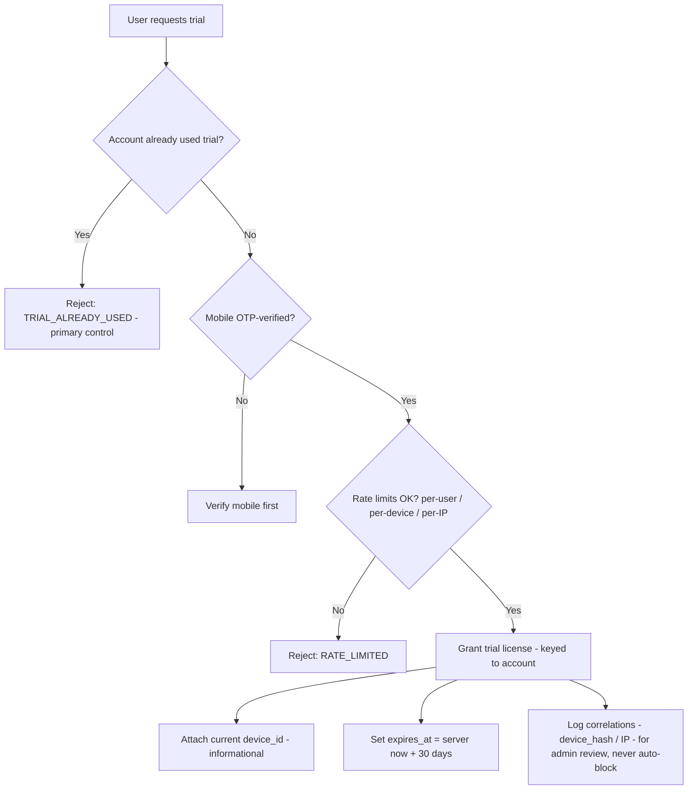

# Eligius Subscription System — Payment & Business Logic

**Version:** 1.0  
**Date:** 2026-11-10  
**Status:** Design Phase — Not Implemented

---

## 1. Overview

This document defines the complete business logic for subscriptions, trials, payments, renewals, and expiration handling. The design is **server-authoritative** — all business decisions happen on the WordPress backend; the Android app is a thin client that displays state and triggers actions.

---

## 2. Subscription Plans

### 2.1 Plan Catalog

| Plan Key | Label | Duration (Days) | Price (IRT) | Discount | Features |
|----------|-------|-----------------|-------------|----------|----------|
| `trial` | Free Trial | 30 | 0 | — | VPN Access, All Servers, Split Tunneling |
| `monthly` | Monthly | 30 | 150,000 | — | VPN Access, All Servers, Split Tunneling, Priority Support |
| `quarterly` | Quarterly | 90 | 400,000 | 10% | VPN Access, All Servers, Split Tunneling, Priority Support |
| `semiannual` | Semi-annual | 180 | 750,000 | 15% | VPN Access, All Servers, Split Tunneling, Priority Support |
| `annual` | Annual | 365 | 1,400,000 | 20% | VPN Access, All Servers, Split Tunneling, Priority Support |

**Plan Configuration** (stored in `eligius_plans` table, editable in wp-admin):
```json
{
  "plans": {
    "trial": {
      "key": "trial",
      "label": "Free Trial",
      "duration_days": 30,
      "price_irt": 0,
      "discount_percent": 0,
      "features": ["vpn.connect", "vpn.split_tunnel", "vpn.lan_share"],
      "is_trial": true,
      "sort_order": 0
    },
    "monthly": {
      "key": "monthly",
      "label": "Monthly",
      "duration_days": 30,
      "price_irt": 150000,
      "discount_percent": 0,
      "features": ["vpn.connect", "vpn.split_tunnel", "vpn.lan_share", "priority_support"],
      "is_trial": false,
      "sort_order": 1
    },
    "quarterly": {
      "key": "quarterly",
      "label": "Quarterly",
      "duration_days": 90,
      "price_irt": 400000,
      "discount_percent": 10,
      "features": ["vpn.connect", "vpn.split_tunnel", "vpn.lan_share", "priority_support"],
      "is_trial": false,
      "sort_order": 2
    },
    "semiannual": {
      "key": "semiannual",
      "label": "Semi-annual",
      "duration_days": 180,
      "price_irt": 750000,
      "discount_percent": 15,
      "features": ["vpn.connect", "vpn.split_tunnel", "vpn.lan_share", "priority_support"],
      "is_trial": false,
      "sort_order": 3
    },
    "annual": {
      "key": "annual",
      "label": "Annual",
      "duration_days": 365,
      "price_irt": 1400000,
      "discount_percent": 20,
      "features": ["vpn.connect", "vpn.split_tunnel", "vpn.lan_share", "priority_support"],
      "is_trial": false,
      "sort_order": 4
    }
  }
}
```

---

## 3. Free Trial Business Logic

### 3.1 Trial Rules

| Rule | Implementation |
|------|----------------|
| **Duration** | 30 days from grant timestamp (server clock) |
| **Eligibility — primary control** | One trial per **account** (`user_id`) — enforced by a server-side uniqueness check on trial licenses per user. **This control is immune to reinstall/clear-data by design** (it does not depend on any device state) |
| **Prerequisite** | Mobile number verified via **OTP** (existing registration flow) + device registered and challenge-verified |
| **Grant Trigger** | User taps "Start Free Trial" in app (device must be registered) |
| **Device Binding at Grant** | Trial license row stores the current `device_id` at activation — informational binding; transferable via the OTP device-transfer workflow |
| **One Active Device (CD-9)** | Applies to the trial **and** all paid plans: exactly one active device per account; transfer via OTP deactivates the old device immediately; enforced server-side with row locking (02 §2.8) |
| **Expiration** | Automatic at `started_at + 30 days` (server cron) |
| **Conversion** | Payment during trial → upgrades to paid, extends from trial expiry |
| **Abuse Deterrence — layered, no complete prevention** | (a) OTP-verified mobile per account (one SIM = one account); (b) server-side rate limits on `/licenses/trial` per user/device/IP; (c) passive anomaly flagging — same `device_hash` across multiple accounts, same-IP clustering → admin review queue, **never auto-block**; (d) per-IP thresholds set generously so CGNAT/shared-IP users are never locked out |
| **Identity Data** | **No mandatory national code** and no other unjustified identity data collection. If identity verification is ever added, it is a separate owner decision (TD-10) |
| **Honest Limitation** | Complete prevention of trial abuse via multi-accounting is **impossible** without identity infrastructure (Shahkar — rejected by prior owner decision). The goal is raising the cost of abuse, not eliminating it. See §5.2 for the reinstall-specific analysis |

### 3.2 Trial Grant Flow

```
┌─────────────────────────────────────────────────────────────────┐
│                    TRIAL GRANT FLOW                             │
├─────────────────────────────────────────────────────────────────┤
│                                                                 │
│  Android App                          WordPress Server          │
│    │                                    │                       │
│    │── POST /license/trial ───────────►│                       │
│    │  { device_hash, hash }            │                       │
│    │                                    │                       │
│    │    Check:                     │                       │
│    │    1. Account already used trial? (primary)          │
│    │    2. Mobile OTP-verified?          │                       │
│    │    3. Rate limits OK (user/device/IP)?                     │
│    │    4. Flag device_hash/IP correlations for review          │
│    │                                    │                       │
│    │◄── { trial_granted: true,        │                       │
│    │      license_id: 456,            │                       │
│    │      expires_at: "2026-12-10..." }│                       │
│    │                                    │                       │
│    │  Create license:                  │                       │
│    │  status = TRIAL                   │                       │
│    │  device_id = device.id           │                       │
│    │  expires_at = now() + 30 days    │                       │
│    │  source = 'trial'                │                       │
│    │  device_hash = request.fingerprint                       │
│    │                                    │                       │
└─────────────────────────────────────────────────────────────────┘
```

**Server Implementation:**
```php
function grant_trial($user_id, $device_hash) {
    global $wpdb;
    
    // SHARED LOCK: same wp_users row as bind_device and transfer — serializes
    // trial grant vs device bind vs transfer, preventing concurrent duplicates.
    $wpdb->query('START TRANSACTION');
    $wpdb->get_row($wpdb->prepare(
        "SELECT ID FROM {$wpdb->users} WHERE ID = %d FOR UPDATE",
        $user_id
    ));
    
    // 1. Verify device belongs to user and is verified (device must be registered)
    $device = $wpdb->get_row($wpdb->prepare(
        "SELECT id FROM {$wpdb->prefix}eligius_devices 
         WHERE device_hash = %s AND user_id = %d AND is_active = 1",
        $device_hash, $user_id
    ));
    
    if (!$device) {
        return error('DEVICE_NOT_FOUND');
    }
    
    // 2. PRIMARY CONTROL: one trial per ACCOUNT (user_id) — immune to reinstall
    $existing_trial = $wpdb->get_var($wpdb->prepare(
        "SELECT id FROM {$wpdb->prefix}eligius_licenses 
         WHERE user_id = %d AND source = 'trial'",
        $user_id
    ));
    
    if ($existing_trial) {
        return error('TRIAL_ALREADY_USED');
    }
    
    // 3. DETERRENCE: same device_hash used for a trial on ANOTHER account → flag
    //    (never auto-block — device_hash does not survive uninstall, so this
    //    catches same-install multi-accounting only; logged for admin review)
    $other_trial = $wpdb->get_var($wpdb->prepare(
        "SELECT l.id FROM {$wpdb->prefix}eligius_licenses l
         JOIN {$wpdb->prefix}eligius_devices d ON l.device_id = d.id
         WHERE d.device_hash = %s AND l.source = 'trial'
         AND l.user_id != %d",
        $device_hash, $user_id
    ));
    
    if ($other_trial) {
        log_audit_event([
            'user_id' => $user_id,
            'device_id' => $device->id,
            'event_type' => 'trial.device_correlation_flag',
            'severity' => 'WARNING',
            'details' => ['other_license_id' => $other_trial]
        ]);
        // NOT rejected — flag only (device correlation is a soft signal)
    }
    
    // 4. Rate limits (per user / per device / per IP) enforced before this
    //    function via the shared rate limiter — see 03-API-SPECIFICATION.md §9
    
    // 5. Create trial license (account-keyed, device-bound informationally)
    $now = current_time('mysql');
    $expires = date('Y-m-d H:i:s', strtotime('+30 days'));
    
    $wpdb->insert("{$wpdb->prefix}eligius_licenses", [
        'user_id' => $user_id,
        'device_id' => $device->id,
        'plan_key' => 'trial',
        'plan_label' => 'Free Trial',
        'duration_days' => 30,
        'started_at' => current_time('mysql'),
        'expires_at' => $expires,
        'status' => 'TRIAL',
        'source' => 'trial'
    ]);
    
    $license_id = $wpdb->insert_id;
    
    // Issue offline entitlement
    $entitlement = License_Issuer::instance()->issue_offline_entitlement($license_id, $device->id);
    
    // Audit
    log_audit_event([
        'user_id' => $user_id,
        'license_id' => $license_id,
        'event_type' => 'trial.granted',
        'device_id' => $device->id
    ]);
    
    $wpdb->query('COMMIT');
    return [
        'license_id' => $license_id,
        'expires_at' => $expires,
        'offline_entitlement' => $entitlement
    ];
}
```

---

## 4. Paid Subscription Business Logic

### 4.1 Purchase Flow

```
┌─────────────────────────────────────────────────────────────────┐
│                    PURCHASE FLOW                                │
├─────────────────────────────────────────────────────────────────┤
│                                                                 │
│  Android App                          WordPress Server          │
│    │                                    │                       │
│    │── POST /payments/create ────────►│                       │
│    │  { plan_key, gateway }            │                       │
│    │                                    │                       │
│    │    Check:                          │                       │
│    │    1. Valid plan_key              │                       │
│    │    2. Valid gateway               │                       │
│    │    3. No active subscription?     │                       │
│    │                                    │                       │
│    │◄── { payment_id, authority,       │                       │
│    │      redirect_url, amount,        │                       │
│    │      expires_in } ────────────────│                       │
│    │                                    │                       │
│    │    Create payment record:         │                       │
│    │    status = INITIATED             │                       │
│    │    gateway_ref = authority        │                       │
│    │                                    │                       │
│    │  Redirect to gateway URL          │                       │
│    │                                    │                       │
│    │                         Gateway    │                       │
│    │                         User pays  │                       │
│    │                         Gateway callback                  │
│    │                         GET /payments/callback/zarinpal   │
│    │                         ?Authority=X&Status=OK           │
│    │                                       │                   │
│    │                    S2S Verification                     │
│    │    POST https://api.zarinpal.com/pg/v4/payment/verify.json │
│    │                                       │                   │
│    │                          { code: 100, ref_id }          │
│    │                                       │                   │
│    │    Verify: code=100, amount matches, ref_id unique     │
│    │                                       │                   │
│    │    Activate license:                              │      │
│    │    - status = ACTIVE                            │      │
│    │    - expires_at = now() + duration (or extend)   │      │
│    │    - payment_id = payment_id                    │      │
│    │                                       │                   │
│    │                         Redirect to app                │
│    │                         eligius://payment/result      │
│    │                                       │                   │
│    │              App polls /licenses/status               │
│    │                                       │                   │
└─────────────────────────────────────────────────────────────────┘
```

### 4.2 Payment Verification (Server-to-Server)

```php
class Eligius_Sub_Payment_Processor {
    private $gateways = [];
    
    public function register_gateway($key, Eligius_Sub_Gateway_Adapter $adapter) {
        $this->gateways[$key] = $adapter;
    }
    
    public function create_payment($user_id, $plan_key, $gateway_key) {
        // Validate plan
        $plan = $this->plan_manager->get_plan($plan_key);
        if (!$plan || $plan->is_trial) {
            throw new Exception('Invalid plan');
        }
        
        // Check existing active subscription
        $existing = $this->license_repo->get_active_license($user_id);
        if ($existing && $existing->status === 'ACTIVE') {
            throw new Exception('ACTIVE_SUBSCRIPTION_EXISTS');
        }
        
        // Get gateway adapter
        if (!isset($this->gateways[$gateway_key])) {
            throw new Exception('GATEWAY_UNAVAILABLE');
        }
        $gateway = $this->gateways[$gateway_key];
        
        // Create payment record
        $payment_id = $this->payment_repo->create([
            'user_id' => $user_id,
            'gateway' => $gateway_key,
            'plan_key' => $plan_key,
            'plan_duration_days' => $plan->duration_days,
            'amount' => $plan->price_irt,
            'currency' => 'IRT',
            'status' => 'INITIATED'
        ]);
        
        // Initiate with gateway
        $result = $gateway->initiate_payment([
            'amount' => $plan->price_irt,
            'description' => "Eligius VPN - {$plan->label}",
            'callback_url' => home_url("/wp-json/eligius/v1/payments/callback/{$gateway_key}"),
            'metadata' => [
                'payment_id' => $payment_id,
                'user_id' => $user_id,
                'plan_key' => $plan_key
            ]
        ]);
        
        // Update payment with gateway reference
        $this->payment_repo->update($payment_id, [
            'gateway_ref' => $result['authority'],
            'authority' => $result['authority']
        ]);
        
        return [
            'payment_id' => $payment_id,
            'redirect_url' => $result['redirect_url'],
            'authority' => $result['authority'],
            'amount_irt' => $plan->price_irt,
            'expires_in' => 1800 // 30 minutes
        ];
    }
    
    public function process_callback($gateway_key, $request) {
        $gateway = $this->gateways[$gateway_key] ?? throw new Exception('Unknown gateway');
        
        // 1. Idempotency check
        $authority = $request['Authority'] ?? $request['authority'] ?? '';
        $idempotency = $this->idempotency_repo->find_by_gateway_ref($gateway_key, $authority);
        
        if ($idempotency && $idempotency->status === 'VERIFIED') {
            return ['duplicate' => true];
        }
        
        // 2. Get payment record
        $payment = $this->payment_repo->find_by_gateway_ref($gateway_key, $authority);
        if (!$payment) {
            throw new Exception('Payment not found');
        }
        
        // 3. Server-to-Server verification
        $verification = $this->gateways[$gateway_key]->verify($request);
        
        if (!$verification['verified']) {
            $this->mark_payment_failed($payment->id, $verification['reason']);
            return ['verified' => false];
        }
        
        // Verify amount matches
        if ($verification['amount'] != $payment->amount) {
            throw new Exception('Amount mismatch');
        }
        
        // Check idempotency
        if ($idempotency && $idempotency->status === 'VERIFIED') {
            return ['duplicate' => true];
        }
        
        // Mark idempotency
        $this->idempotency_repo->upsert($gateway_key, $request['Authority'], 'VERIFIED', $request);
        
        // Update payment
        $this->payment_repo->update($payment_id, [
            'status' => 'VERIFIED',
            'verified_at' => current_time('mysql'),
            'gateway_response' => $response
        ]);
        
        // Activate/extend license
        $this->activate_license($payment->user_id, $payment->plan_key, $payment->id);
        
        // Audit
        $this->audit_logger->log('payment.verified', [
            'payment_id' => $payment_id,
            'user_id' => $payment->user_id,
            'gateway' => $gateway,
            'amount' => $payment->amount
        ]);
        
        return ['success' => true];
    }
}
```

---

## 3. Payment Gateway Adapters

### 3.1 Gateway Interface

```php
interface Eligius_Sub_Gateway_Adapter {
    public function get_key(): string; // 'zarinpal', 'idpay', 'zibal'
    public function get_name(): string;
    
    /**
     * Initiate payment
     * @return ['authority' => string, 'redirect_url' => string]
     */
    public function initiate_payment(array $params): array;
    
    /**
     * Verify payment via server-to-server API
     * @return ['verified' => bool, 'amount' => int, 'ref_id' => string, 'reason' => string]
     */
    public function verify_payment(array $callback_data): array;
    
    public function get_callback_url(): string;
    public function supports_refund(): bool;
    public function refund(string $gateway_ref, int $amount): array;
}
```

### 3.2 ZarinPal Adapter

```php
class Eligius_Sub_Zarinpal_Adapter implements Eligius_Sub_Gateway_Adapter {
    private $merchant_id;
    private $callback_url;
    private $sandbox;
    private $base_url;
    
    public function __construct($config) {
        $this->merchant_id = $config['merchant_id'];
        $this->callback_url = $config['callback_url'];
        $this->sandbox = $config['sandbox'] ?? false;
        $this->base_url = $this->sandbox 
            ? 'https://sandbox.zarinpal.com/pg/v4' 
            : 'https://api.zarinpal.com/pg/v4';
    }
    
    public function get_key(): string { return 'zarinpal'; }
    public function get_name(): string { return 'ZarinPal'; }
    public function get_callback_url(): string { return $this->callback_url; }
    public function supports_refund(): bool { return true; }
    
    public function initiate_payment(array $params): array {
        $response = wp_remote_post("{$this->base_url}/payment/request.json", [
            'body' => json_encode([
                'merchant_id' => $this->merchant_id,
                'amount' => $params['amount'],
                'callback_url' => $this->callback_url,
                'description' => $params['description'],
                'metadata' => $params['metadata'] ?? []
            ]),
            'headers' => ['Content-Type' => 'application/json']
        ]);
        
        $body = json_decode(wp_remote_retrieve_body($response), true);
        
        if (($body['data']['code'] ?? 0) !== 100) {
            throw new Exception('ZarinPal request failed: ' . ($body['data']['message'] ?? 'Unknown'));
        }
        
        $authority = $body['data']['authority'];
        $redirect = $this->sandbox 
            ? "https://sandbox.zarinpal.com/pg/StartPay/{$authority}"
            : "https://www.zarinpal.com/pg/StartPay/{$authority}";
        
        return [
            'authority' => $authority,
            'redirect_url' => $redirect
        ];
    }
    
    public function verify_payment(array $callback): array {
        $authority = $callback['Authority'] ?? '';
        $status = $callback['Status'] ?? '';
        
        if ($status !== 'OK') {
            return ['verified' => false, 'reason' => 'User cancelled or failed'];
        }
        
        $response = wp_remote_post("{$this->base_url}/payment/verify.json", [
            'body' => json_encode([
                'merchant_id' => $this->merchant_id,
                'authority' => $authority,
                'amount' => $amount // from stored payment
            ]),
            'headers' => ['Content-Type' => 'application/json']
        ]);
        
        $body = json_decode(wp_remote_retrieve_body($response), true);
        
        if (($body['data']['code'] ?? 0) === 100) {
            return [
                'verified' => true,
                'amount' => $body['data']['amount'] ?? 0,
                'ref_id' => $body['data']['ref_id'] ?? ''
            ];
        }
        
        return ['verified' => false, 'reason' => $body['data']['message'] ?? 'Verification failed'];
    }
    
    public function refund(string $gateway_ref, int $amount): array {
        $response = wp_remote_post("{$this->base_url}/payment/refund.json", [
            'body' => json_encode([
                'merchant_id' => $this->merchant_id,
                'authority' => $gateway_ref,
                'amount' => $amount
            ]),
            'headers' => ['Content-Type' => 'application/json']
        ]);
        
        $body = json_decode(wp_remote_retrieve_body($response), true);
        
        return [
            'success' => ($body['data']['code'] ?? 0) === 100,
            'ref_id' => $body['data']['ref_id'] ?? ''
        ];
    }
}
```

### 3.3 IDPay Adapter

```php
class Eligius_Sub_Idpay_Adapter implements Eligius_Sub_Gateway_Adapter {
    private $api_key;
    private $callback_url;
    private $sandbox;
    private $base_url = 'https://api.idpay.ir/v1.1';
    
    public function __construct($config) {
        $this->api_key = $config['api_key'];
        $this->callback_url = $config['callback_url'];
        $this->sandbox = $config['sandbox'] ?? false;
        if ($this->sandbox) {
            $this->base_url = 'https://api.sandbox.idpay.ir/v1.1';
        }
    }
    
    public function get_key(): string { return 'idpay'; }
    public function get_name(): string { return 'IDPay'; }
    
    public function initiate_payment(array $params): array {
        $response = wp_remote_post("{$this->base_url}/payment", [
            'headers' => [
                'Content-Type' => 'application/json',
                'X-API-KEY' => $this->api_key,
                'X-SANDBOX' => $this->sandbox ? '1' : '0'
            ],
            'body' => json_encode([
                'order_id' => $params['metadata']['payment_id'],
                'amount' => $params['amount'],
                'name' => $params['metadata']['user_name'] ?? 'Eligius User',
                'phone' => $params['metadata']['user_mobile'] ?? '',
                'mail' => $params['metadata']['user_email'] ?? '',
                'desc' => $params['description'],
                'callback' => $this->callback_url
            ])
        ]);
        
        $body = json_decode(wp_remote_retrieve_body($response), true);
        
        if (!isset($body['id'], $body['link'])) {
            throw new Exception('IDPay request failed: ' . ($body['message'] ?? 'Unknown'));
        }
        
        return [
            'authority' => $body['id'],
            'redirect_url' => $body['link']
        ];
    }
    
    public function verify_payment(array $callback): array {
        $id = $callback['id'] ?? '';
        $status = $callback['status'] ?? '';
        
        if ($status !== '10') {
            return ['verified' => false, 'reason' => 'Payment not confirmed'];
        }
        
        $response = wp_remote_post("{$this->base_url}/payment/inquiry", [
            'headers' => [
                'Content-Type' => 'application/json',
                'X-API-KEY' => $this->api_key,
                'X-SANDBOX' => $this->sandbox ? '1' : '0'
            ],
            'body' => json_encode(['id' => $id])
        ]);
        
        $body = json_decode(wp_remote_retrieve_body($response), true);
        
        if (($body['status'] ?? 0) === 100) {
            return [
                'verified' => true,
                'amount' => $body['amount'] ?? 0,
                'ref_id' => $body['id'] ?? ''
            ];
        }
        
        return ['verified' => false, 'reason' => $body['message'] ?? 'Verification failed'];
    }
}
```

---

## 4. Subscription Lifecycle Management

### 4.1 License Activation

```php
class Eligius_Sub_License_Manager {
    public function activate_license($user_id, $plan_key, $payment_id, $device_id = null) {
        global $wpdb;
        
        $plan = $this->plan_manager->get_plan($plan_key);
        $duration = $plan->duration_days;
        
        // Find existing active/expired license for this user
        $existing = $this->license_repo->get_latest_license($user_id);
        
        $now = current_time('mysql');
        $started_at = current_time('mysql');
        
        // Determine start date for renewal
        if ($existing && $existing->status === 'ACTIVE' && $existing->expires_at > current_time('mysql')) {
            // Extend from current expiry
            $started_at = $existing->expires_at;
        } elseif ($existing && $existing->status === 'EXPIRED') {
            // Start from now
            $started_at = current_time('mysql');
        }
        
        $expires_at = date('Y-m-d H:i:s', strtotime("+{$duration} days", strtotime($started_at)));
        
        $wpdb->insert("{$wpdb->prefix}eligius_licenses", [
            'user_id' => $user_id,
            'device_id' => $device_id,
            'plan_key' => $plan_key,
            'plan_label' => $plan->label,
            'duration_days' => $plan->duration_days,
            'started_at' => $started_at,
            'expires_at' => $expires_at,
            'status' => 'ACTIVE',
            'source' => 'payment',
            'payment_id' => $payment_id,
            'previous_license_id' => $existing ? $existing->id : null
        ]);
        
        $license_id = $wpdb->insert_id;
        
        // Update device binding if provided
        if ($device_id) {
            $wpdb->update(
                "{$wpdb->prefix}eligius_devices",
                ['is_active' => 1],
                ['id' => $device_id]
            );
            $wpdb->update(
                "{$wpdb->prefix}eligius_licenses",
                ['device_id' => $device_id],
                ['id' => $wpdb->insert_id]
            );
        }
        
        // Audit
        $this->audit_logger->log('license.activated', [
            'license_id' => $license_id,
            'user_id' => $user_id,
            'plan_key' => $plan_key,
            'source' => 'payment'
        ]);
        
        return (int)$wpdb->insert_id;
    }
}
```

### 3.2 Renewal Logic

```php
function process_renewal($user_id, $plan_key, $gateway) {
    $existing = $this->license_repo->get_latest_license($user_id);
    
    if (!$existing) {
        throw new Exception('NO_EXISTING_LICENSE');
    }
    
    $plan = $this->plan_manager->get_plan($plan_key);
    $duration = $plan->duration_days;
    $now = current_time('mysql');
    
    // Determine start date
    if ($existing->status === 'ACTIVE' && $existing->expires_at > current_time('mysql')) {
        // Extend from current expiry
        $started_at = $existing->expires_at;
    } else {
        // Expired or no active license - start from now
        $started_at = current_time('mysql');
    }
    
    $expires_at = date('Y-m-d H:i:s', strtotime("+{$duration} days", strtotime($started_at)));
    
    // Create renewal payment
    $payment_id = $this->payment_processor->create_payment($user_id, $plan_key, $gateway);
    
    // Create new license record (links to previous)
    $wpdb->insert("{$wpdb->prefix}eligius_licenses", [
        'user_id' => $user_id,
        'plan_key' => $plan_key,
        'plan_label' => $plan->label,
        'duration_days' => $duration,
        'started_at' => $started_at,
        'expires_at' => $expires_at,
        'status' => 'PENDING_PAYMENT',
        'source' => 'renewal',
        'payment_id' => $payment_id,
        'previous_license_id' => $license_id
    ]);
    
    return ['payment_id' => $payment_id, 'expires_at' => $expires_at];
}
```

---

## 4. Expiration & Grace Period

### 4.1 Expiration Processing (Daily Cron)

```php
function eligius_sub_process_expirations() {
    global $wpdb;
    
    // Find licenses expiring today or already expired
    $expired = $wpdb->get_results($wpdb->prepare(
        "SELECT * FROM {$wpdb->prefix}eligius_licenses 
         WHERE status = 'ACTIVE' AND expires_at <= %s",
        current_time('mysql')
    ));
    
    foreach ($expired as $license) {
        // Update status
        $wpdb->update(
            "{$wpdb->prefix}eligius_licenses",
            ['status' => 'EXPIRED', 'updated_at' => current_time('mysql')],
            ['id' => $license->id]
        );
        
        // Audit
        log_audit_event([
            'license_id' => $license->id,
            'user_id' => $license->user_id,
            'event_type' => 'license.expired',
            'old_status' => 'ACTIVE',
            'new_status' => 'EXPIRED',
            'severity' => 'WARNING'
        ]);
        
        // Notify user (email/push)
        notify_user_subscription_expired($license->user_id, $license->plan_label);
    }
}
add_action('eligius_sub_daily_expiry_check', 'eligius_sub_process_expirations');
```

### 3.3 Grace Period & Offline Entitlement

| Scenario | Behavior |
|----------|----------|
| **Online** | Real-time validation via `/licenses/status` |
| **Offline (< 72h)** | Use signed offline entitlement blob (JWT) |
| **Offline (> 72h)** | Deny access, require online validation |
| **Expired + Online** | Show expired UI, offer renewal |
| **Expired + Offline** | Deny (blob expired or validation fails) |

**Offline Entitlement Validity:**
- Max validity: **72 hours** from issuance
- Signed with server's Ed25519 private key
- Contains: `license_id`, `device_hash`, `expires_at`, `permissions`
- Verified on device using embedded public key (rotated via APK updates)

---

## 4. Renewal Logic

### 4.1 Renewal Rules

| Scenario | Behavior |
|----------|----------|
| **Renew before expiry** | Extend from current `expires_at` (e.g., 30 days added to 2026-12-01 → 2026-12-31) |
| **Renew after expiry** | Start from `now()` (e.g., expired 2026-11-01, renew 2026-11-05 → expires 2026-12-05) |
| **Plan change** | New plan duration applies from renewal date |
| **Duplicate payment** | Idempotency key prevents double-charge |

### 4.2 Auto-Renewal (Optional)

```php
function process_auto_renewals() {
    global $wpdb;
    
    // Find licenses expiring in 3 days with auto_renew meta
    $renewals = $wpdb->get_results($wpdb->prepare("
        SELECT l.* FROM {$wpdb->prefix}eligius_licenses l
        JOIN {$wpdb->usermeta} um ON um.user_id = l.user_id
        WHERE l.status = 'ACTIVE' 
        AND l.expires_at BETWEEN NOW() AND DATE_ADD(NOW(), INTERVAL 3 DAY)
        AND um.meta_key = 'eligius_auto_renew'
        AND um.meta_value = '1'
    "));
    
    foreach ($renewals as $license) {
        // Attempt payment with saved payment method
        // If successful → extend license
        // If failed → notify user, retry in 24h
    }
}
```

---

## 4. Expiration Handling

### 4.1 VPN Access Control

```kotlin
// In TunnelService.kt - startSession()
private fun startSession() {
    // LICENSE GATE - THE ENFORCEMENT POINT
    val licenseResult = LicenseStore.ensureValid()
    
    if (!licenseResult.isValid) {
        Engine.lastReason.value = when (licenseResult.error) {
            "SUBSCRIPTION_EXPIRED" -> "Subscription expired. Please renew."
            "NO_ACTIVE_LICENSE" -> "No active subscription"
            "DEVICE_NOT_BOUND" -> "Device not authorized"
            else -> "License validation failed"
        }
        Engine.status.value = Status(Phase.IDLE, 0)
        return
    }
    
    // Proceed with connection...
    job = scope.launch { run(settings) }
}
```

### 4.2 Mid-Session Revocation

| Policy | Behavior |
|--------|----------|
| **Confirmed behavior (CD-5)** | Server revokes → device CRL cache refreshes (≤ 5 min) → next validation tick fails → tunnel stops. **Maximum revocation latency: 5 minutes** — not instantaneous. |
| **Offline** | New revocation undetectable; offline entitlement remains valid until its 72-hour expiry (owner-approved trade-off, CD-4/CD-5) |

---

## 5. Trial Abuse Prevention

### 5.1 Layered Trial Policy



**Layer summary:**

| Layer | Control | Nature | Effectiveness |
|-------|---------|--------|---------------|
| 1 | One trial per `user_id` (DB uniqueness) | **Hard** | 100% for its scope — reinstall/clear-data cannot reset it (account-keyed) |
| 2 | OTP-verified mobile per account | **Hard** (structural) | Each account costs one OTP-capable SIM — the main economic deterrent |
| 3 | Server-side rate limits (user / device / IP) | Soft | Raises cost; **IP thresholds generous** — CGNAT/shared-IP users are flagged, never blocked |
| 4 | Passive anomaly flagging (device_hash across accounts, IP clustering) | Soft | Feeds the wp-admin review queue; catches same-install multi-accounting |

### 5.2 Reinstall & Multi-Account Behavior (Honest Analysis)

| Scenario | Behavior | Why |
|----------|----------|-----|
| Uninstall + Reinstall (same account) | Trial remains consumed | The account-keyed control (Layer 1) does not depend on any device state — Keystore destruction is irrelevant to the trial decision |
| Clear app data (same install) | Trial remains consumed | Same reason |
| New account on the **same install** | Trial granted (passes Layer 1) — but same `device_hash` → **flagged** (Layer 4) | Keystore keys survive app-data clear but not uninstall; correlation catches the lazy attacker |
| New account + uninstall/reinstall (fresh Keystore) | Trial granted — no local correlation survives | **Accepted residual risk**: Keystore keys are destroyed on uninstall (Android 6.0+); device correlation across reinstalls is not achievable |
| Factory reset | New `ANDROID_ID` + fresh Keystore → trial granted | Accepted residual risk |
| Multi-SIM farming | Each account costs one OTP-capable SIM; IP/device correlations accumulate in the review queue | Layer 2 is the economic deterrent; complete prevention requires identity infrastructure (Shahkar — rejected by prior owner decision) |

**Summary:** the trial is protected primarily by the **account-keyed one-time rule** (which is absolute and reinstall-proof) and economically by the **OTP-verified SIM requirement**. Detection layers 3–4 raise the cost of farming without harming legitimate users behind shared IPs. **Complete prevention of multi-account trial abuse is not claimed and is not achievable without identity infrastructure.**

---

## 6. Device Transfer Workflow

```
┌─────────────────────────────────────────────────────────────────┐
│                    DEVICE TRANSFER FLOW                         │
├─────────────────────────────────────────────────────────────────┤
│                                                                 │
│  User (old device)          Server          User (new device)   │
│      │                         │                   │            │
│      │── POST /transfer/start ─►│                   │            │
│      │  { to_device_hash }      │                   │            │
│      │                         │                   │            │
│      │◄── { transfer_id,        │                   │            │
│      │      otp_sent: true }    │                   │            │
│      │                         │                   │            │
│      │                         │   SMS OTP         │            │
│      │                         │─────────────────►│            │
│      │                         │                   │            │
│      │                         │◄── User enters    │            │
│      │                         │      OTP          │            │
│      │                         │                   │            │
│      │                         │  POST /transfer/verify        │
│      │                         │  { transfer_id, otp }         │
│      │                         │                   │            │
│      │                         │  Verify OTP                 │
│      │                         │  Swap device bindings       │
│      │                         │  Update license device_id   │
│      │                         │                   │            │
│      │◄── { verified: true } ──│                   │            │
│      │                         │                   │            │
└─────────────────────────────────────────────────────────────────┘
```

**Security Controls:**
- **One Active Device (CD-9):** after a verified transfer, the old device's `is_active=0` and `license.device_id` moves — the old device fails validation at its next tick and can no longer use the VPN
- Rate limit: 3 transfers/day/user
- OTP TTL: 10 minutes
- Audit log entry on every transfer
- Admin can block specific devices

---

## 6. Administrative Operations

| Operation | Endpoint | Effect |
|-----------|----------|--------|
| Manual Activation | `POST /admin/licenses/{id}/activate` | Set status=ACTIVE, set expires_at |
| Manual Extension | `POST /admin/licenses/{id}/extend` | Add days to `expires_at` |
| Suspension | `POST /admin/licenses/{id}/suspend` | Set status=EXPIRED (reversible) |
| Cancellation | `POST /admin/licenses/{id}/cancel` | Set status=EXPIRED, prevent renewal |
| Revocation | `POST /admin/licenses/{id}/revoke` | Set status=REVOKED (terminal) |
| Device Release | `POST /admin/devices/{id}/release` | Set `is_active=0`, unbind license |

---

## 7. Business Logic Summary

| Component | Key Rules |
|-----------|-----------|
| **Free Trial** | 30 days, **account-keyed** (one per `user_id`), device-bound at grant (informational), OTP-verified mobile prerequisite, reinstall-proof |
| **Paid Plans** | 30/90/180/365 days, extend from expiry (if active) or now (if expired) |
| **Renewal** | Extend from current expiry (if active) or now (if expired) |
| **Expiration** | Daily cron → EXPIRED status, immediate VPN block |
| **Grace Period** | 72h offline entitlement (signed JWT) |
| **Revocation** | Immediate (CRL checked every 5 min) |
| **Trial** | One per device_hash, 30 days, device-bound |
| **Device Binding** | One active device/user, Keystore ECDSA P-256 |
| **Device Transfer** | OTP-verified, rate-limited (3/day) |
| **Payment** | S2S verification, idempotent, gateway-agnostic |
| **Refund** | Marks license REVOKED/EXPIRED, audit logged |

---

*End of Payment & Business Logic Document*